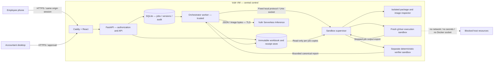

# Architecture

## Decision

One Vultr Ubuntu 24.04 VM hosts Caddy, static React assets, FastAPI, a durable orchestrator worker and a narrow local sandbox supervisor. SQLite and immutable files stay on the host. Untrusted generated Python runs in a fresh Docker container under gVisor `runsc`. This is a modular monolith with an execution boundary, not a distributed platform.

Prefer `vc2-4c-8gb` in `sto` for room for the app and two bounded sandbox jobs. Catalog presence is not a capacity guarantee. gVisor's `systrap` platform avoids depending on nested KVM; its platform documentation recommends this approach inside VMs. [gVisor platform guide](https://gvisor.dev/docs/architecture_guide/platforms/)

## Trust boundaries

The inspector and verifier also parse untrusted packages in isolated processes. Calling a parser “trusted” does not make the uploaded XML safe. Their code and policy are trusted; their inputs are not. They receive no inference credentials.

## Modules and responsibilities

| Module | Owns | Must never own |
|---|---|---|
| API | Session/tenant authorization, input bounds, endpoint responses | Docker socket, arbitrary command execution |
| Orchestrator | State transitions, VSI requests, budgets, leases | Executing generated code locally |
| Accounting policy | Minor-unit arithmetic, duplicate keys, plan admission | LLM arithmetic or inferred legal treatment |
| Workbook inspector | Package manifest, mapping evidence and features | Saving or normalizing original workbooks |
| Mapping service | Confirmed semantic map, layout compatibility hash | Credentials or implicit write permissions |
| Supervisor | Fixed runtime settings, staging, deadlines, output collection, cleanup | User-selected images, mounts, command flags |
| Generated program | Calculate approved postings and produce candidate copy | Database, approval endpoint, original workbook store |
| Verifier | Reparse before/after, exact delta/feature checks | Trusting generated manifest/stdout as proof |
| Version service | Immutable object hashes and atomic current pointer | Rerunning code during approval |

## Happy-path sequence

1. Accountant uploads workbook; API stores immutable bytes and original SHA-256. Inspector validates package and inventories structure.
2. VSI proposes mapping from a bounded structural representation. Deterministic checks validate coordinates; accountant confirms account semantics, write regions and policy. Confirmation creates an immutable mapping revision.
3. Employee photographs receipt via mobile web capture/file picker. Isolated image normalizer verifies magic bytes, dimensions and format, strips metadata, and emits bounded JPEG/PNG bytes.
4. Worker sends normalized image to VSI, extracts transaction fields and evidence. Deterministic checks reject incomplete totals; uncertain fields become review tasks.
5. Load mapping, policy, duplicate registry and current workbook version. VSI proposes a balanced accounting plan and Python in one structured response. Software checks entries and allocates exact blank slots.
6. If allocated slots differ from model suggestions, pass the **final admitted plan and coordinates** to a code-only generation call within budget; never silently execute code against a changed plan.
7. Supervisor stages only source copy, mapping subset, admitted plan and generated program. Execute in a fresh gVisor container with no network or secrets.
8. Stop entire job before exporting output; enforce byte/file limits and destroy writable job state. Independent verifier compares candidate against source, plan and preservation policy in a separate sandbox.
9. Verifier report and host-computed artifact hashes enter database. All sandbox resources must be destroyed before `AWAITING_APPROVAL`.
10. Desktop displays receipt, structured values, entry explanation, generated program, actual logs, cell diff, warnings, and candidate download. Accountant approves the exact hash tuple.
11. Version service performs atomic compare-and-swap against current workbook version and records one commit. Clients see the same durable event stream.

## Files and authority

Originals and committed versions are immutable objects addressed by SHA-256, stored outside any sandbox mount. Candidate files are frozen before presentation. Never use the filename supplied by a user as a host path. Display names are metadata only.

Generated manifests are hints. The verifier independently discovers the candidate file, computes cell changes, parses money and checks the exact expected multiset of postings. Validation report authority comes from the verifier's supervisor-recorded run, not a JSON field written by generated Python.

A mapping's semantic identity can survive a routine value append. Its compatible layout hash covers sheet IDs/names, header anchors, protected and formula regions, styles relevant to mapping, merges, validation rules and instruction/account evidence. Before every run, software checks compatibility **and occupancy** against the actual current bytes. Do not require full-file hash equality to reuse a mapping, and do not reuse a full-file hash as if it proved unchanged layout.

## Atomic commit and crash consistency

Use the database's workbook current-version pointer as the only authority. A mutable `current.xlsx` file is unnecessary.

Before database mutation, safely copy the validated candidate to a content-addressed immutable object on the same filesystem, close it, fsync its file and parent directory, and recompute its hash. That object must already exist durably when a committed database row can reference it. A crash here leaves an unreferenced object that can be collected later.

Within a short `BEGIN IMMEDIATE` transaction:

1. Recheck actor role, tenant, run state, unexpired approval, mapping/policy versions, candidate/report/plan hashes and candidate existence.
2. Read current version and compare it to the approved base ID and hash.
3. Check unique transaction commit and approval constraints.
4. Insert the workbook version and commit record, atomically update current-version pointer conditional on the expected old value, and append audit event/outbox row.
5. Commit the database transaction. A crash afterward is recovered from the committed rows; retry returns the same commit.

One winner succeeds when two runs approve the same base. The loser receives `STALE_BASE`, retains its uncommitted candidate for review, and requires an explicit fresh run and approval. There is no automatic merge. SQLite supports early write acquisition through `BEGIN IMMEDIATE`; handle `SQLITE_BUSY` with bounded retries and keep LLM/sandbox work outside transactions. [SQLite transaction documentation](https://sqlite.org/lang_transaction.html)

## Failures and lifecycle

Worker leases and database events survive API/worker restarts. Every attempt carries an epoch/fencing token. Stale worker output cannot replace newer output. Supervisor-enforced maximum lifetime survives worker death; a host reaper removes orphan jobs. Cleanup failures hold the run in `CLEANUP_PENDING`, disable approval and alert the team.

Per VM permit at most two running isolation jobs total, including inspectors/verifiers, and one execution writer per workbook. Receipt extraction can overlap within configured VSI concurrency. No lock is held during human approval. Queue admission prevents unlimited uploads from exhausting storage.

## Mobile/desktop synchronization

Use the same HTTPS origin and server database on both devices. Employee sessions can upload and view their own runs; accountant/owner sessions can confirm mappings and approve. SSE sends durable state/event updates; GET run snapshots reconcile after reconnect. No workbook content is cached in a service worker. PWA installation/offline submission is P1.

P0 uses separately provisioned invited sessions on both devices. P1 QR pairing grants upload-only scope, lasts two minutes and is single-use, with the secret in a URL fragment, exchanged by POST. No account-wide API key or approval capability belongs in a QR code.

## Scale boundary

SQLite and local storage fit the single-host demo and low concurrency. Move to PostgreSQL, object storage, a durable distributed queue and dedicated sandbox hosts when scaling to multiple application hosts. This change is justified by required concurrency and durability, not transaction count alone. Never advertise multi-tenant hostile-code production isolation based only on this one-host prototype.
